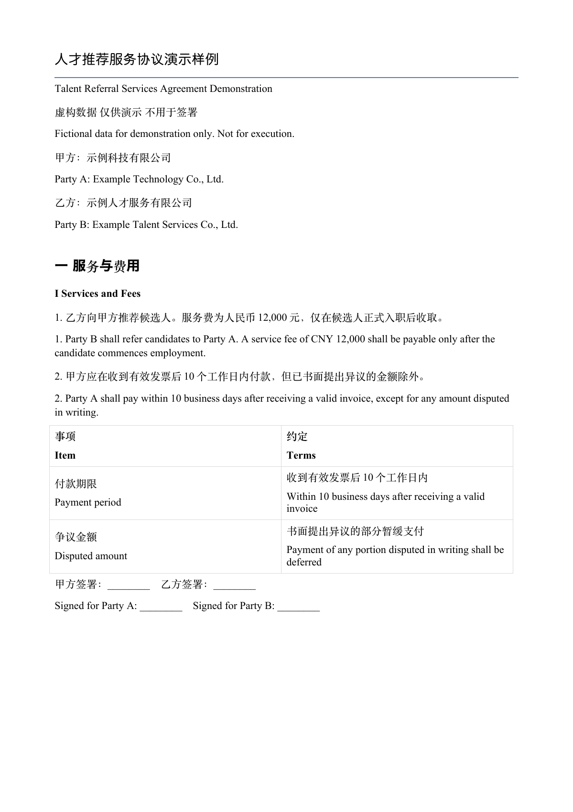

# 合同双语翻译

**把合同做成方便审阅、讨论和修改的中英对照 Word。**

收到一份英文合同，想对照中文理解条款；或者要把中文协议发给境外客户，双方需要逐条确认内容。这套工具帮助你完成合同翻译，并把原文和译文整理在同一份 Word 中，方便继续审阅和修改。

[下载使用](https://github.com/The-Data-Galaxy/translate-legal-contracts/releases/tag/v0.1.3) · [看看做出来的双语稿](docs/demo/bilingual.docx)

## 本次更新

v0.1.3把制作、检查和排版修正接入同一执行流程：先检查文档结构，再生成页图核对；发现断表时保留译文，只调整布局。检查过程记录次数，相同版本复用已有结果，达到已批准范围即停止并说明未完成项。

已在WorkBuddy用一份真实猎头合同新建对话、提交一段业务要求复测：21页双语Word，两次渲染、成品补丁0。真实合同不公开。该宿主另有Python文件代理兼容问题，测试中自行调整了单次命令环境；这不是Skill通用操作建议，也不代表所有软件环境均已验证。

[从SkillHub获取](https://skillhub.cn/skills/user_00aaeaf9/zhulingfeng-contract-bilingual-translation) · [本版验证范围](benchmark/README.md)

## 什么时候用得上

- **看英文合同。** 在英文条款旁保留对应中文，遇到拿不准的表达，可以回到原文核对。
- **把中文合同交给境外客户。** 准备一份中英对照稿，双方对着同一条讨论付款、责任和例外，减少来回查找。
- **整理已经翻译过的合同。** 检查前后译名、金额、期限和条款引用，再把稿件整理成可继续修改的 Word。

翻译时保留合同原来的交易安排。发现原文有矛盾或术语有疑问，会单独说明，不通过译文替你修改合同。

## 第一次怎么用

先将这套工具添加到支持 Skill、能够读写 Word 的 AI 助手中。首次配置可看[安装说明](docs/cli.md#安装与调用补充)；不同软件的操作有所不同。

装好以后，每次使用只需准备原合同，并告诉 AI 三件事：**译成哪种语言、给谁看、有没有必须沿用的译名或格式。** 优先提供 Word 文件；PDF 和扫描件还需要识别文字、重新整理版面。

例如，把合同作为附件发给 AI，再复制下面这段话：

> 请使用“合同双语翻译”，把这份中文合同做成中英对照 Word，供双方核对。保留中文原文和条款编号，英文统一11号字。请特别核对金额、付款条件、期限、责任和例外。原文有矛盾或不确定的译法，请单独列出来，不要替我修改合同。

如果客户已有固定称谓，可以补一句：“甲方统一译为 Client，乙方统一译为 Service Provider。”有自己的合同模板，也可以一并提供。

## 实际工作中怎样走完一遍

假设你要把一份人才推荐服务协议发给境外同事确认：

1. **你发出原合同。** 附上中文版 Word，说明要做成中英对照稿，供对方审阅。
2. **你交代具体要求。** 告诉 AI 双方的英文名称、已有译名和格式要求。只有影响处理的重要信息缺失时，它才需要追问。
3. **AI 交回双语稿。** 原文和译文逐条放在一起，表格、附件和签署位置也纳入处理；有疑问的地方单独说明。
4. **你核对关键交易条件。** 例如，服务费是“候选人正式入职后才收取”，不能变成“推荐候选人后就收取”；“收到有效发票后10个工作日付款”也不能漏掉发票条件或把工作日改成自然日。
5. **你提出修改，再发给对方。** 比如“把全文的服务提供方统一译为 Service Provider”，或“第2条的争议金额例外请再对照原文核查”。修改后再检查相关条款和页面。

你最终拿到的是一份**可继续修改的双语 Word**，有实质疑问时附简短说明。默认中文在前，英文紧随对应条款，原合同另行保留。对外发送或签署前，仍由你复核重要条款。

## 看看实际做出的文件

下面是一份虚构人才推荐协议制作出的双语稿截图。你可以直接看到原文与译文如何对应，以及表格、付款条件和签署位置怎样呈现。

[看中文原稿](docs/demo/source.docx) · [下载双语稿](docs/demo/bilingual.docx) · [查看原稿截图](docs/demo/source-page-1.png)

这是实际生成并查看过的文件，全部内容为虚构示例。实际效果会受到合同内容、所用 AI 和文档软件的影响。这份短示例供你了解交付形式，重要条款仍须结合原文复核。

## 使用时留意什么

- 合同翻译与合同审查分别处理。你需要的法律修改建议，应与忠实译文区分开。
- 自动目录、修订记录、批注、复杂表格和扫描件，可能需要额外整理。尚未完成的内容或页面检查，应在交付时明确说明。
- 如果发现译名或条款有问题，指出具体位置和希望怎样处理即可。公开反馈问题时，请先隐去客户、签名和账号信息。

[反馈问题](https://github.com/The-Data-Galaxy/translate-legal-contracts/issues) · [详细使用规则](SKILL.md) · [演示记录](docs/demo/README.md) · [技术说明](docs/cli.md)

## 作者与使用许可

署名：**朱玲凤**。

说明文字、使用方法和演示素材采用 **CC BY 4.0**；程序代码采用 **Apache-2.0**。可以按相应许可商用、修改和分享，并保留作者署名、许可及修改说明。你的合同和译文不因使用本工具而自动适用这份开源许可。

[完整许可范围](LICENSE) · [版本记录](CHANGELOG.md)
